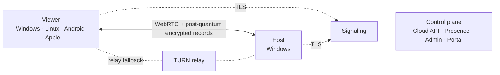
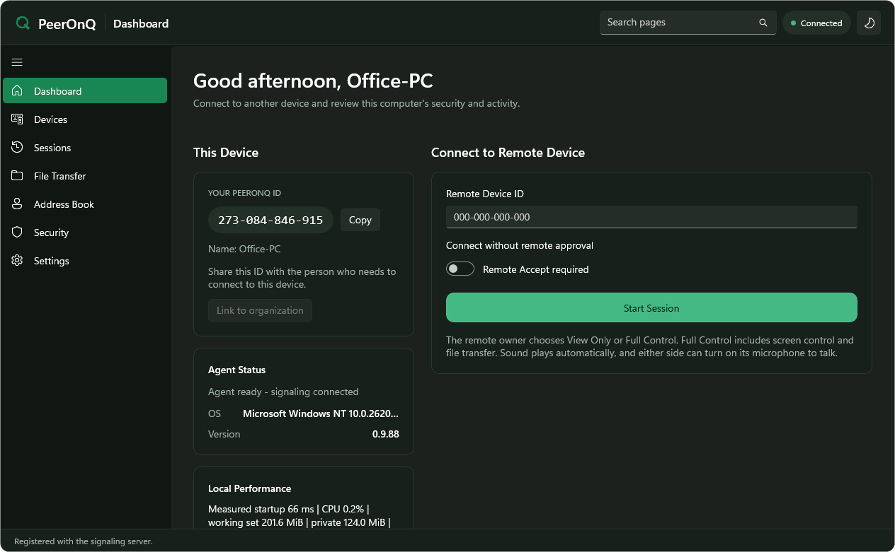
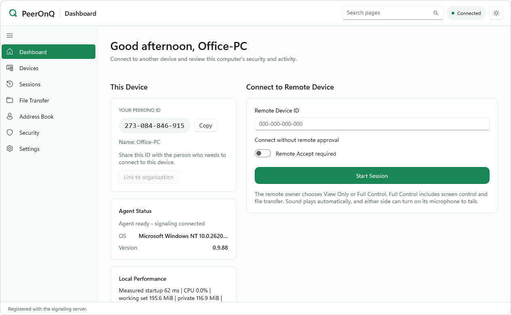
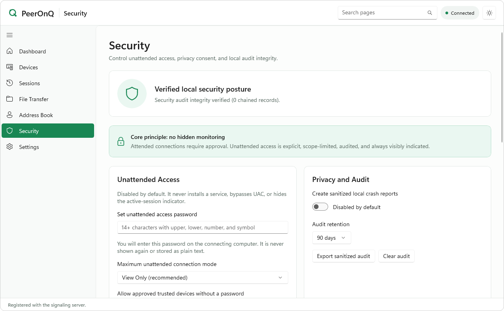
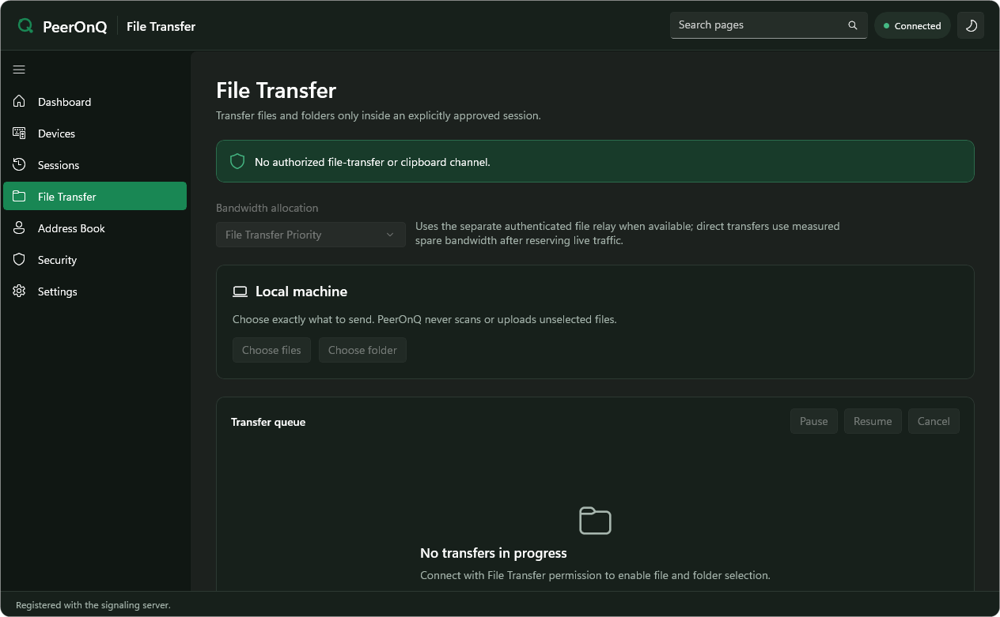

<div align="center">

<picture>
  <source media="(prefers-color-scheme: dark)" srcset="artifacts/peeronq/public/brand/peeronq-lockup-light.svg">
  
</picture>

### Secure remote access with post-quantum encryption

Open-source remote desktop with native clients and a self-hosted control plane.<br>
**Connect securely. Work anywhere.**

[](LICENSE)
[](docs/SECURE_TRANSPORT.md)
[](global.json)
[](artifacts/peeronq)
[](docs/KNOWN_LIMITATIONS.md)

[Website](https://peeronq.com) · [Security model](docs/SECURITY.md) · [Documentation](#documentation) · [Changelog](CHANGELOG.md) · [Contributing](CONTRIBUTING.md) · [Screenshots](#screenshots)

</div>

---

PeerOnQ lets you view and control another computer over a direct, end-to-end encrypted
connection. Every session combines a classical and a post-quantum key exchange, every action
needs the remote side's consent, and the whole service stack can run on your own server.

> [!NOTE]
> PeerOnQ is in a **public pilot (0.9.88)**. Builds from this repository are pre-release and the
> Windows installers are not yet production-signed. See [Known limitations](docs/KNOWN_LIMITATIONS.md).

## Why PeerOnQ

| | |
| --- | --- |
| **Post-quantum by default** | Each session runs a hybrid ML-KEM-768 + X25519 key exchange with ML-DSA-65 + Ed25519 authentication, designed to keep traffic recorded today safe from future quantum computers. |
| **Your servers see nothing** | Signaling and relay servers route encrypted packets only. They never receive keys, screen images, keystrokes, clipboard text or files. |
| **Consent first** | The remote side approves every session. View, control, clipboard and file transfer are separate permissions that can be reduced at any time, never silently expanded. |
| **Smooth and sharp** | 60 fps by default and up to 120 fps on high-refresh displays, hardware H.264 with VP8 fallback, GPU capture and adaptive quality. |
| **Self-hosted** | One installer sets up signaling, TURN relay, cloud API, admin console, account portal and monitoring on your own Linux server. |
| **Open source** | MIT licensed, built from source in public CI, with a documented security model. |

## Post-quantum security

PeerOnQ does not rely on WebRTC encryption alone. A mandatory application security layer runs
inside every session, and both peers must support it before the session is created.

| Layer | How it is protected |
| --- | --- |
| Key establishment | Ephemeral **ML-KEM-768** (FIPS 203) combined with ephemeral **X25519**: an attacker has to break both |
| Peer authentication | **ML-DSA-65** (FIPS 204) + **Ed25519** signatures over the full handshake transcript, bound to each device's ECDSA P-256 identity |
| Key derivation | HKDF-SHA-512 with independent keys per direction, channel, file transfer and key epoch |
| Session data | **AES-256-GCM** for video, input, audio, clipboard and files, with replay protection and automatic rekeying (1 GiB, 1 million records, 30 minutes or reconnect) |
| Transport | WebRTC DTLS-SRTP as an additional layer underneath |
| Forward secrecy | Ephemeral keys are discarded after the handshake, so a stolen device key cannot decrypt past sessions |
| Device keys | Windows DPAPI, Linux Secret Service, Android Keystore or Apple Keychain |
| Relay access | Short-lived HMAC TURN credentials issued per session; no static passwords in clients |
| Updates | ECDSA P-256 signed manifests, SHA-256 package hashes and pinned Authenticode publishers |

Downgrade attempts, wrong identities, transcript tampering and any data sent before the handshake
completes are rejected. The protocol is specified in [Secure transport](docs/SECURE_TRANSPORT.md).

> The post-quantum algorithms come from the Bouncy Castle 2.7.0 managed implementation of FIPS 203
> and FIPS 204. It is not a FIPS-certified module, and an independent cryptographic review is
> still planned.

## Features

### Remote sessions

- **View Only, Full Control and File Transfer** modes, approved by the remote owner.
- **Multiple monitors**, each remote display in its own window.
- **Sound and voice**: system sound starts automatically, and either side can turn on its
  microphone (Opus), subject to the organization's audio policy.
- **File and folder transfer** with per-chunk and whole-file SHA-256 verification. Files travel
  only over direct connections, never through the relay.
- **Clipboard sync** for text, off by default.
- **Address book and trusted devices**, with trust granted only after a verified session.
- **Instant Support links** with 256-bit tokens, expiry, use limits and an optional password.
- **Unattended access**, off by default: the password never leaves the host, connections are
  limited to a permission ceiling, and every use is visibly indicated.
- **Portable Support mode** that runs without installation and installs no service.
- **Network Doctor** with real STUN and TURN probes and plain-language results.

### Safety controls

- A visible indicator and tray controls for every live session, plus a global
  **Ctrl+Alt+Shift+F12** emergency stop.
- The host can revoke control without ending the view; reconnecting cannot restore it.
- Input is released immediately on reconnect, focus loss or revocation. PeerOnQ never bypasses UAC,
  the secure desktop or Ctrl+Alt+Delete.
- A tamper-evident, hash-chained local security audit with configurable retention.
- Crash reporting is off by default; diagnostics are sanitized and never contain passwords, keys,
  clipboard content, file names or screen content.

### Self-hosted control plane

- Signaling with authenticated, replay-protected registration and session resume after network
  interruptions or server restarts.
- Hardened coturn TURN relay with quotas and blocked private ranges.
- Cloud API, presence and downloads services; admin console with MFA and role-based access;
  account portal with organizations, teams and session policies.
- Signed device attestations that enforce organization policy, allowed modes and relay regions.
- PostgreSQL and Redis, with OpenTelemetry, Prometheus, Grafana, Loki and Tempo.
- A single self-extracting Linux installer with TLS setup, migrations, health checks and
  one-step rollback.

## Platforms

| Platform | Role | Status |
| --- | --- | --- |
| Windows 10 and 11 (x64, ARM64) | Host, viewer and controller | Public pilot, MSI installers |
| Linux desktop (x64, ARM64) | Viewer and controller | Preview |
| Android 7.1 and later | Viewer and controller | Source available, not yet published |
| macOS, iOS and iPadOS | Viewer and controller | Source available, not yet published |
| Linux server | Signaling, TURN and control plane | Self-hosted pilot |

Every platform has its own release gates; see [Platform capabilities](docs/CROSS_PLATFORM_CAPABILITIES.md).

## Architecture

Clients find each other through the signaling service, then connect directly over WebRTC. When no
direct path exists, encrypted media is relayed through TURN. Neither service can read session
content.



<details>
<summary><b>Repository layout</b></summary>

```text
src/                         .NET 10 product
  PeerOnQ.Domain             Core model
  PeerOnQ.Application        Session coordination, policies and post-quantum handshake
  PeerOnQ.Infrastructure     Persistence, cloud client and updates
  PeerOnQ.Transport          WebRTC, ICE, STUN and TURN transport
  PeerOnQ.Media              Capture, codecs, audio and adaptive quality
  PeerOnQ.Platform.*         Windows, Linux, Android and Apple integrations
  PeerOnQ.App*               Native clients (WinUI 3, Avalonia, Android, Apple)
  PeerOnQ.Service.Windows    Windows session broker service
  PeerOnQ.Signaling.Server   Real-time signaling service
  PeerOnQ.Presence.Server    Device presence service
  PeerOnQ.Cloud.*            Cloud API and domain
  PeerOnQ.Admin.Api          Administration API
  PeerOnQ.Downloads.Service  Release downloads
  PeerOnQ.*.Deployment       Compose, Nginx, TLS and monitoring definitions
tests/                       .NET test projects
installer/                   WiX installer for Windows (x64, ARM64)
packaging/                   Linux and Android packaging
eng/                         Build of the maintained SIPSorcery derivative from pinned source
artifacts/
  peeronq/                   Website (React 19, Vite, Tailwind CSS 4)
  peeronq-admin/             Admin console
  peeronq-portal/            Account portal
  api-server/                Minimal Express API
lib/                         OpenAPI specification and generated TypeScript clients
scripts/                     Build, release, quality and operations scripts
docs/                        Architecture, security, deployment and operations documentation
```

</details>

## Getting started

### Prerequisites

- Windows 11 or a supported Windows 10 release for the Windows client
- [.NET SDK 10.0.402](https://dotnet.microsoft.com/download/dotnet/10.0) (pinned in `global.json`)
- [Node.js 24](https://nodejs.org/) and pnpm 10.33.0 through Corepack (`npm` and `yarn` are rejected)
- Docker with Linux containers for the server stack
- Visual Studio Build Tools and the Windows SDK to build installers

### Build and test

```powershell
corepack enable
pnpm install --frozen-lockfile

# Build the maintained SIPSorcery derivative from its pinned source (needed before restore)
dotnet run --project eng/PeerOnQ.DependencyBuilder -c Release -- --output eng/sipsorcery/packages

dotnet restore PeerOnQ.slnx
dotnet build PeerOnQ.slnx -c Release --no-restore
dotnet test PeerOnQ.slnx -c Release --no-build

pnpm run typecheck
pnpm run lint
pnpm run test
pnpm run build
```

The [local development guide](docs/LOCAL_DEVELOPMENT.md) covers the local signaling and TURN
stack, the full control-plane workspace, testing with two Windows computers on a trusted LAN, and
the website's environment variables.

<details>
<summary><b>Building Windows installers</b></summary>

Development installers are built with `scripts/windows/build-phase5-development.ps1`. The
public-pilot builder produces an unsigned, test-only MSI whose updater trusts only the compiled
manifest key and publisher fingerprint. Supplying all three update-trust values enables verified
updates; omitting all three produces an update-disabled build:

```powershell
.\scripts\windows\build-peeronq-public-pilot.ps1 `
  -Architectures x64 `
  -UpdateChannel beta `
  -UpdatePublicKeySpkiBase64 $env:PEERONQ_UPDATE_PUBLIC_KEY_SPKI `
  -UpdateKeyId $env:PEERONQ_UPDATE_KEY_ID `
  -PublisherCertificateSha256 $env:PEERONQ_PUBLISHER_CERTIFICATE_SHA256 `
  -IUnderstandThisIsNotProductionSigned
```

See [Installer](docs/INSTALLER.md) and [Enterprise deployment](docs/ENTERPRISE_DEPLOYMENT.md).

</details>

<details>
<summary><b>Changing the API contract</b></summary>

Edit `lib/api-spec/openapi.yaml`, then regenerate the clients. Do not edit generated files by hand.

```bash
pnpm --filter @workspace/api-spec run codegen
```

</details>

## Deployment

The self-extracting Linux server bundle (`peeronq-server-<version>.run`) installs and upgrades the
complete server stack, including TLS, migrations, health checks and rollback. Docker Engine with
Compose, public DNS and firewall or NAT rules are host prerequisites. Follow the
[Deployment guide](docs/DEPLOYMENT.md).

To run only signaling and TURN, start from `.env.production.example`, keep the populated file
outside the repository, and validate the configuration first:

```bash
cd src/PeerOnQ.Realtime.Deployment
docker compose --env-file /secure/peeronq.env -f docker-compose.production.yml config
docker compose --env-file /secure/peeronq.env -f docker-compose.production.yml up -d --build
```

For day-to-day operation see [Operations](docs/OPERATIONS.md), [Runbooks](docs/RUNBOOKS.md) and
[High availability and disaster recovery](docs/HA_AND_DISASTER_RECOVERY.md).

## Built with

.NET 10 · WinUI 3 · Avalonia · SIPSorcery WebRTC · libvpx · Media Foundation · Bouncy Castle ·
Concentus (Opus) · ASP.NET Core · PostgreSQL · Redis · coturn · React 19 · Vite · Tailwind CSS ·
OpenTelemetry · Prometheus · Grafana · WiX

## Documentation

| Topic | Documents |
| --- | --- |
| Overview | [Architecture](docs/ARCHITECTURE.md), [Platform capabilities](docs/CROSS_PLATFORM_CAPABILITIES.md), [Known limitations](docs/KNOWN_LIMITATIONS.md) |
| Security and privacy | [Security model](docs/SECURITY.md), [Secure transport](docs/SECURE_TRANSPORT.md), [Threat model](docs/THREAT_MODEL.md), [Privacy](docs/PRIVACY.md), [Data retention](docs/DATA_RETENTION.md) |
| Development | [Local development](docs/LOCAL_DEVELOPMENT.md), [Performance](docs/PERFORMANCE.md), [Protocol compliance](docs/PROTOCOL_COMPLIANCE.md), [Standards baseline](docs/STANDARDS_BASELINE.md) |
| Releases | [Installer](docs/INSTALLER.md), [Update security](docs/UPDATE_SECURITY.md), [Code signing policy](CODE_SIGNING_POLICY.md), [Release checklist](docs/RELEASE_CHECKLIST.md), [Release notes](src/PeerOnQ.Infrastructure.Deployment/RELEASE_NOTES.md) |
| Operations | [Deployment](docs/DEPLOYMENT.md), [Operations](docs/OPERATIONS.md), [Runbooks](docs/RUNBOOKS.md), [Incident response](docs/INCIDENT_RESPONSE.md), [Support diagnostics](docs/SUPPORT_DIAGNOSTICS.md) |
| Licensing | [Third-party notices](THIRD_PARTY_NOTICES.md), [Dependencies](DEPENDENCIES.md), [License audit](docs/THIRD_PARTY_LICENSE_AUDIT.md) |

## Contributing

Contributions are welcome. Read [CONTRIBUTING.md](CONTRIBUTING.md) before opening an issue or a
pull request, and follow the [Code of conduct](CODE_OF_CONDUCT.md).

**Security issues:** please report vulnerabilities privately as described in
[SECURITY.md](SECURITY.md), not in public issues.

## Code signing

Windows release installers are built by GitHub Actions from a tagged commit
([release-windows.yml](.github/workflows/release-windows.yml)) and signed through SignPath: free code
signing provided by SignPath.io, certificate by SignPath Foundation. Release signing requires manual
approval. The [code signing policy](CODE_SIGNING_POLICY.md) lists what is signed, the team roles and
what the app sends over the network. The signing program application is pending until the
SIPSorcery license restriction described in [docs/signing/APPLY.md](docs/signing/APPLY.md) is
resolved. Local and test builds are unsigned.

## License

PeerOnQ is released under the [MIT License](LICENSE). Third-party components keep their own
licenses; see [THIRD_PARTY_NOTICES.md](THIRD_PARTY_NOTICES.md). Some bundled dependencies carry
additional terms, in particular the SIPSorcery license's geographic use restriction, which is
documented there.

## Screenshots

The Windows client (0.9.88) in dark and light themes.

<p align="center">
  
</p>

<table>
  <tr>
    <td width="33%"></td>
    <td width="33%"></td>
    <td width="33%"></td>
  </tr>
  <tr>
    <td align="center"><sub><b>Dashboard</b>: connect by PeerOnQ ID</sub></td>
    <td align="center"><sub><b>Security</b>: verified audit, unattended access, privacy</sub></td>
    <td align="center"><sub><b>File Transfer</b>: only inside an approved session</sub></td>
  </tr>
</table>
